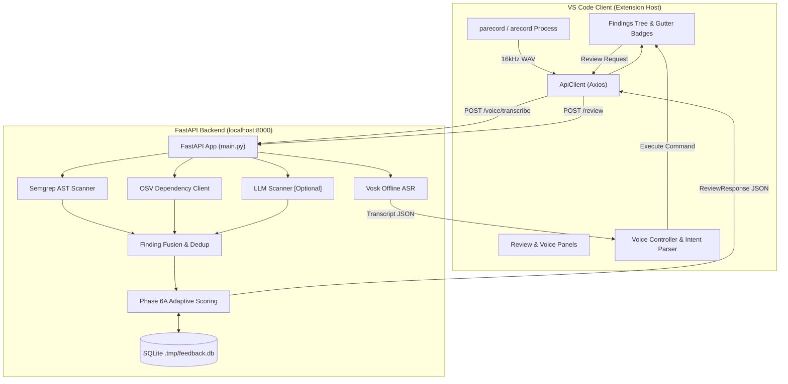

# AI Code Review Assistant

[](#testing--evaluation-summary)
[](#testing--evaluation-summary)
[](#prerequisites)

A developer-focused security review assistant inside **Visual Studio Code**, backed by an asynchronous **FastAPI** microservice. It couples static AST security analysis (Semgrep) and dependency CVE lookups (Google OSV API) with an explainable AI subsystem (XAI), local offline speech recognition (Vosk), and adaptive risk prioritization driven by developer feedback.

---

## Table of Contents

- [Key Features](#key-features)
- [Architecture](#architecture)
- [Tech Stack](#tech-stack)
- [Prerequisites](#prerequisites)
- [Installation & Setup](#installation--setup)
- [Quick Start](#quick-start)
- [User Manual](#user-manual)
- [VS Code Commands Reference](#vs-code-commands-reference)
- [Backend REST API](#backend-rest-api)
- [Testing & Evaluation Summary](#testing--evaluation-summary)
- [Project Structure](#project-structure)
- [Troubleshooting](#troubleshooting)
- [Limitations, Privacy & Roadmap](#limitations-privacy--roadmap)
- [Evaluation Charts & Demo Checklist](#evaluation-charts--demo-checklist)
- [License](#license)

---

## Key Features

### Core Analysis & Intelligence
- **Static Security Analysis:** Scans code using Semgrep for OWASP Top 10 vulnerabilities (SQLi, command injection, path traversal, hardcoded secrets, weak crypto).
- **Dependency Vulnerability Scanning:** Audits `requirements.txt`, `package.json`, `go.mod`, and `pom.xml` asynchronously via the OSV Batch API.
- **Finding Fusion & Scoring:** Merges overlapping multi-scanner alerts and assigns normalized risk scores (`Critical`, `High`, `Medium`, `Low`).
- **Explainable AI (XAI) & Fixes:** Generates structured explanations, line highlights, and remediation diffs. *Optional LLM layer (Gemini/OpenAI) falls back gracefully to rule templates when unconfigured.*
- **Adaptive Prioritization (Phase 6A):** Learns from developer feedback (accept/reject) stored in local SQLite (`.tmp/feedback.db`) to demote noisy false-positive rules.

### Local Voice Interaction
- **Offline Speech-to-Text:** 100% local, zero-cloud speech recognition using Vosk (Kaldi ASR engine).
- **Linux Audio Capture:** Native host capture (`parecord` / `arecord`) bypasses VS Code webview iframe permission restrictions.
- **Deterministic Intent Parser:** Normalizes conversational prefixes and maps spoken requests (`"review this file"`, `"show critical"`, `"explain finding 1"`) to IDE commands.

### Experimental Modules (Isolated / Non-Production)
- **Contextual-Bandit RL (Phase 6B):** Reinforcement learning ranking policy (opt-in via `USE_RL_PRIORITIZATION=1`). Phase 6A deterministic adaptive scoring remains the production default.
- **Multimodal Intent Fusion:** Prototype fusing voice text and code context to disambiguate commands (documented in `experiments/multimodal/`).

---

## Architecture



---

## Tech Stack

- **Backend:** FastAPI `^0.110.0`, Uvicorn `^0.27.0`, Python 3.14.7, Pydantic v2.
- **Security & ASR:** Semgrep `^1.60.0`, Vosk `^0.3.45` (`vosk-model-small-en-us-0.15`), HTTPX `^0.27.0`.
- **Persistence:** aiosqlite `^0.19.0`, SQLite3.
- **VS Code Extension:** TypeScript 5.3, VS Code Extension API `^1.85.0`, Axios `^1.6.0`.
- **System Audio:** PipeWire / PulseAudio (`parecord`), ALSA (`arecord`), FFmpeg.

---

## Prerequisites

- **OS:** Linux (tested on Arch Linux, kernel `6.18.x`; compatible with Ubuntu/Debian/Fedora).
- **Runtimes:** Python 3.10–3.14, Node.js `>= 18.0.0`, npm `>= 9.0.0`, VS Code `>= 1.85.0`.
- **System Tools (Linux Audio):**
  ```bash
  # Arch Linux
  sudo pacman -S pipewire-pulse alsa-utils ffmpeg
  # Ubuntu / Debian
  sudo apt-get update && sudo apt-get install pulseaudio-utils alsa-utils ffmpeg
  ```

---

## Installation & Setup

```bash
# 1. Clone repository
git clone git@github.com:Shivansh246/ai-code-review-assistant.git
cd ai-code-review-assistant

# 2. Setup Python environment & backend dependencies
python3 -m venv backend/.venv
source backend/.venv/bin/activate
pip install -r backend/requirements.txt

# 3. Configure environment
cp .env.example .env

# 4. Download offline Vosk English speech model (~40 MB)
./backend/.venv/bin/python backend/download_vosk_model.py

# 5. Install & compile VS Code extension
cd vscode-extension
npm install
npm run compile
cd ..
```

---

## Quick Start

Running the application requires two processes:

**Terminal 1 — Start Backend Server:**
```bash
PYTHONPATH=backend ./backend/.venv/bin/python -m uvicorn main:app --app-dir backend --host 127.0.0.1 --port 8000
```
*Verify readiness:* `curl http://127.0.0.1:8000/health` $\rightarrow$ `{"status":"healthy","service":"ai-review-backend"}`.

**Terminal 2 — Launch Extension Development Host:**
- Press `F5` in VS Code (using `.vscode/launch.json`), or run:
```bash
/usr/bin/code --user-data-dir /tmp/ai-code-review-vscode-profile --new-window \
  --extensionDevelopmentPath=$(pwd)/vscode-extension $(pwd)
```

---

## User Manual

1. **Review File:** Open a source file (e.g., `evaluation/test_samples/vulnerable_app.py`) and press `Ctrl+Shift+R`. Findings appear in the editor gutter and the **AI Security Findings** sidebar tree.
2. **Review Repository & Dependencies:** Run **AI Review: Review Repository** from the Command Palette (`Ctrl+Shift+P`). Analyzes code files and dependency manifests (`requirements.txt`, etc.).
3. **Inspect XAI & Fix:** Click any finding in the tree to navigate to line numbers. Right-click and choose **AI Review: Explain Finding** for structured explanations, or **AI Review: Generate Fix** for code diffs.
4. **Adaptive Feedback:** Click `(✓)` to **Accept** or `(✗)` to **Reject** an alert. Rejections decrease rule risk scores in SQLite, demoting future false positives.
5. **Voice Assistant:** Press `Ctrl+Shift+V` to open the Voice Assistant panel. Click **Start Recording**, speak a command (e.g., *"review this file"*, *"show critical"*), and click **Stop Recording**. The action executes automatically. Use the built-in simulator buttons if no microphone is connected.

---

## VS Code Commands Reference

| Command Label | Command ID | Keybinding | Expected Result |
| :--- | :--- | :--- | :--- |
| **AI Review: Review Current File** | `aiReview.reviewFile` | `Ctrl+Shift+R` | Scans active file; updates tree view and gutter badges. |
| **AI Review: Review Repository** | `aiReview.reviewRepo` | — | Scans workspace code and dependency manifests. |
| **AI Review: Explain Finding** | `aiReview.explainFinding` | — | Displays XAI breakdown and evidence snippet. |
| **AI Review: Show Critical Findings** | `aiReview.showCritical` | `Ctrl+Shift+C` | Opens QuickPick filter for Critical/High findings. |
| **AI Review: Generate Fix** | `aiReview.generateFix` | — | Generates remediation diff in editor. |
| **AI Review: Open Review Panel** | `aiReview.openPanel` | — | Opens webview review dashboard. |
| **AI Review: Start Voice Command** | `aiReview.startVoice` | `Ctrl+Shift+V` | Opens voice panel and begins host audio capture. |
| **AI Review: Stop Voice** | `aiReview.stopVoice` | — | Stops capture and triggers transcription. |
| **AI Review: Accept Finding** | `aiReview.acceptFinding` | — | Submits positive feedback; maintains rule weight. |
| **AI Review: Reject Finding** | `aiReview.rejectFinding` | — | Submits false-positive feedback; demotes rule weight. |
| **AI Review: Show Voice Metrics** | `aiReview.voiceMetrics` | — | Shows activations, VAD counts, and latency table. |

---

## Backend REST API

Base URL: `http://127.0.0.1:8000`

| Endpoint | Method | Input Summary | Success Response | Description |
| :--- | :--- | :--- | :--- | :--- |
| `/health` | `GET` | None | `{"status":"healthy",...}` | Liveness check used on extension activation. |
| `/review` | `POST` | `{"file_path","content",...}` | `ReviewResponse` (findings, scores) | Single-file Semgrep, OSV, and LLM parallel scan. |
| `/review/repo` | `POST` | `{"repo_path": "..."}` | `ReviewResponse` (workspace findings) | Workspace-level Semgrep and OSV manifest scan. |
| `/explain` | `POST` | `{"finding_id": "..."}` | `ExplainResponse` (factors, XAI) | Detailed explanation and evidence highlights. |
| `/fix` | `POST` | `{"finding_id","content"}` | `FixResponse` (patch diff) | Remediation suggestion. |
| `/feedback` | `POST` | `{"finding_id","status",...}` | `{"status":"recorded",...}` | Stores user feedback and updates adaptive weights. |
| `/voice/transcribe`| `POST` | Multipart audio file ($\le 10\text{ MB}$) | `{"transcript": "..."}` | Offline Vosk speech-to-text transcription. |

---

## Testing & Evaluation Summary

### Test Commands
```bash
# 1. Backend Unittests (Regression, Vosk, Fusion, Adaptive Scoring)
PYTHONPATH=backend ./backend/.venv/bin/python -m unittest discover -s backend -v
# Result: 102 passed, 0 failed (0.45s)

# 2. VS Code Extension TypeScript Build & Mocked Voice Tests
cd vscode-extension && npm run compile && node ./out/test/runVoiceTests.js
# Result: 0 TypeScript errors; 107 passed, 0 failed
```

### Key Verified Results
*Complete raw metrics, methodologies, and audit records live in [`evaluation/evaluation_report.md`](evaluation/evaluation_report.md) and [`evaluation/results/validity_audit.md`](evaluation/results/validity_audit.md).*

- **Vulnerability Detection (Semgrep + OSV, LLM disabled):** Precision: `0.333`, Recall: `0.571`, F1: `0.421` ($TP=8, FP=16, FN=6$ on 14 ground-truth benchmark flaws). Precision reflects Semgrep firing secondary rules outside the benchmark.
- **Dependency Scanning:** Audited 3 packages (`jinja2`, `requests`, `flask`); returned 26 advisory records representing **13 unique CVE clusters** in `1.07s`.
- **Adaptive Prioritization:** Phase 6A deterministic scoring achieved Top-3 $F_1 = 1.000$ by demoting the target FP from Rank 2 to 5 (60% score reduction), outperforming sparse RL.
- **Multimodal Intent (Proof-of-Concept):** Transcript-only accuracy was `51.67%` (showing developer utterance ambiguity), while code context fusion reached `100.0%` on synthetic templates. *Qualified in audit as a synthetic template discriminator rather than an acoustic ASR classifier.*
- **System Latency:** `/health` mean `2.24 ms`; `/review` single-file mean `4.69 s` (includes Semgrep execution and remote OSV batch query).

---

## Project Structure

```
ai-code-review-assistant/
├── backend/                  # FastAPI microservice
│   ├── main.py               # Endpoints (/health, /review, /explain, /fix, /voice)
│   ├── scanner_semgrep.py    # Semgrep AST static analysis
│   ├── scanner_osv.py        # OSV client for dependency manifests
│   ├── scanner_llm.py        # Optional Gemini / OpenAI semantic scanner
│   ├── scoring.py            # Static, adaptive (Phase 6A), and RL ranking
│   ├── vosk_service.py       # Offline Vosk speech recognition
│   └── test_regression.py    # Backend test suite (102 tests)
├── vscode-extension/         # TypeScript VS Code Extension
│   ├── src/extension.ts      # Extension activation & command handlers
│   ├── src/voiceController.ts# Native host audio capture & intent parser
│   └── src/test/runVoiceTests.ts # Voice regression test suite (107 tests)
├── evaluation/               # Benchmark suites, reports, and validity audit
│   ├── evaluation_report.md  # Detailed experimental findings
│   └── results/validity_audit.md # Scientific validity audit & qualifications
└── experiments/multimodal/   # Audio-code fusion intent classification experiment
```

---

## Troubleshooting

- **Backend Connection Refused:** Verify the backend is running (`curl http://127.0.0.1:8000/health`) and port `8000` is open.
- **Vosk Model Missing (HTTP 503):** Run `./backend/.venv/bin/python backend/download_vosk_model.py`.
- **Recorder Binary Missing:** Install `pipewire-pulse` or `alsa-utils` (`which parecord` / `which arecord`).
- **Empty Audio / 44-byte WAV:** Verify microphone volume and default input device in system audio settings (`pavucontrol`).
- **Commands Missing from Palette:** Compile the extension via `cd vscode-extension && npm run compile`.
- **Optional LLM Inactive:** Configure `GEMINI_API_KEY` or `OPENAI_API_KEY` in `.env`. Rule-based fallback remains active without keys.

---

## Limitations, Privacy & Roadmap

- **Limitations:** Semgrep uses pattern heuristics that can trigger false positives on custom sanitizers. Linux audio capture currently targets `parecord`/`arecord`. Automated voice tests evaluate IPC/intent logic; real-world microphone accuracy depends on ambient noise.
- **Privacy & Security:** Code scanning, Vosk speech-to-text, and adaptive feedback execute **100% locally**. The only external calls are package name/version lookups to `api.osv.dev` and optional LLM requests when explicitly configured with API keys. Source code is never sent to OSV. Never commit `.env` or secrets.
- **Roadmap:** Cross-platform audio daemons (macOS/Windows), local LLM integration via Ollama, and multi-file taint graph tracking.

---

## Evaluation Charts & Demo Checklist

Generated evaluation plots reside in [`evaluation/results/charts/`](evaluation/results/charts/):
- [`security_detection_metrics.png`](evaluation/results/charts/security_detection_metrics.png) — Precision, recall, and F1 counts.
- [`security_by_severity.png`](evaluation/results/charts/security_by_severity.png) — Breakdown across Critical, High, and Medium.
- [`prioritisation_comparison.png`](evaluation/results/charts/prioritisation_comparison.png) — Static vs Adaptive vs RL ranking.
- [`intent_classification.png`](evaluation/results/charts/intent_classification.png) — Transcript-only vs Multimodal fusion.
- [`performance_latency.png`](evaluation/results/charts/performance_latency.png) — Latency distributions.

*Presentation Checklist:* Ensure live demos showcase the sidebar findings tree, inline gutter decorations, XAI explanation modal, and voice assistant panel.

---

## License

No formal open-source license file is currently provided. All rights are reserved by the authors. Developed as an academic Computer Science / Artificial Intelligence engineering project.
